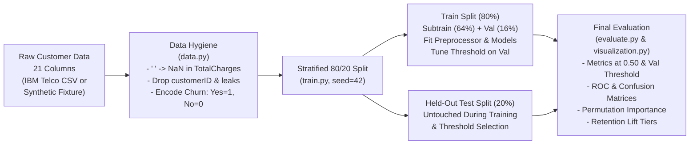

# ChurnLens: An End-to-End Customer Churn Prediction and Model Evaluation Pipeline

**ChurnLens** is a clean, reproducible classical machine learning repository built with Python and `scikit-learn` to predict customer churn, compare linear and nonlinear baseline models (`LogisticRegression` vs. `RandomForestClassifier`), analyze precision-recall threshold trade-offs under class imbalance, and translate predicted probabilities into prioritized retention outreach tiers.

---

## 1. Problem Statement & Motivation

Customer churn occurs when subscribers cancel a recurring service. Predicting which customers are at risk allows a retention team to focus outreach budgets on high-risk subscribers rather than offering blanket discounts across the entire customer base.

**ChurnLens** answers five core engineering and analytical questions:
1. **Model Comparison**: How does an interpretable $L_2$-regularized Logistic Regression baseline compare against a regularized Random Forest classifier on tabular customer attributes?
2. **Precision vs. Recall Trade-offs**: How does shifting the classification probability threshold $\tau$ balance wasted outreach (False Positives) against missed churners (False Negatives)?
3. **Class Imbalance**: Why is raw accuracy misleading when only ~22–27% of customers churn, and how do `class_weight="balanced"`, F1-score, and ROC-AUC address this?
4. **Feature Association**: Which customer attributes (e.g., `Contract`, `tenure`, `MonthlyCharges`) drive model predictions according to held-out permutation importance versus internal impurity/coefficient weights?
5. **Business Prioritization**: How can a retention team rank customers by predicted churn probability to maximize lift within a fixed outreach budget?

> **Scope & Causality Note**: This pipeline predicts a binary target variable (`Churn`) from historical observational attributes. It does **not** prove causal relationships or guarantee real-world churn/revenue reduction without a separate randomized controlled retention experiment (uplift study).

---

## 2. Key Features

- **Leakage-Safe Preprocessing (`src/churnlens/preprocessing.py`)**: Uses `scikit-learn` `ColumnTransformer` and `Pipeline` so median/mode imputation (`SimpleImputer`), numerical scaling (`StandardScaler`), and categorical encoding (`OneHotEncoder(handle_unknown="ignore")`) are fitted **exclusively on training data**.
- **Real-World Data Hygiene (`src/churnlens/data.py`)**: Automatically coerces whitespace-corrupted numeric strings (`" "` in `TotalCharges` for `tenure == 0` customers) to `NaN`, removes unique identifiers (`customerID`), and guards against target-leakage columns.
- **Three-Way Stratified Isolation (`src/churnlens/train.py`)**: Isolates a stratified 20% held-out test set (`random_state=42`) and derives a separate stratified validation split from the 80% training partition strictly for threshold tuning ($\tau \in [0.20, 0.80]$).
- **Dual Feature Importance (`src/churnlens/evaluate.py`)**: Computes held-out test **Permutation Importance** (`scoring="roc_auc"`) alongside Random Forest Gini importance and Logistic Regression signed coefficients.
- **Automated CPU Unit Tests & Cross-Platform CI (`tests/`)**: 11 fast `pytest` tests verifying missing-value handling, training-only scaler/imputer statistics, probability bounds, metric calculations, and reproducibility across Linux and Windows.

---

## 3. Architecture & Workflow Diagram



---

## 4. Dataset Source & Attribution

- **Primary Benchmark Dataset**: **IBM Telco Customer Churn** dataset published by IBM Developer / IBM Sample Data.
  - **Official Source Repository**: [IBM/telco-customer-churn-on-icp4d](https://github.com/IBM/telco-customer-churn-on-icp4d)
  - **Direct Raw CSV URL**: `https://raw.githubusercontent.com/IBM/telco-customer-churn-on-icp4d/master/data/Telco-Customer-Churn.csv`
  - **Target Variable (`Churn`)**: `"Yes"` encoded as `1` (positive class) and `"No"` encoded as `0` (negative class).
  - **Official Dataset Schema**: `7,043` rows and `21` columns (`1` identifier `customerID`, `4` numeric attributes `SeniorCitizen`, `tenure`, `MonthlyCharges`, `TotalCharges` with `11` blank `" "` strings at `tenure == 0`, `15` categorical service/contract/billing attributes, and `1` binary target `Churn` with `26.54%` positive churn rate).
- **Offline Synthetic Fixture (`--use-synthetic`)**: When running in an isolated environment without outbound internet access, `src/churnlens/data.py` provides `generate_synthetic_telco_fixture(n_samples=600, random_state=42)`, which reproduces the exact 21-column schema, blank `" "` strings in `TotalCharges` (`12` rows), and class imbalance (`21.83%` positive churn rate, `131` `Yes` / `469` `No`). All outputs explicitly record `data_source` (`ibm_telco_csv` vs. `synthetic_fixture`).

---

## 5. Installation & Windows-Friendly Commands

### Windows PowerShell
```powershell
# 1. Navigate into the repository
cd ChurnLens

# 2. Create and activate a virtual environment
python -m venv .venv
.\.venv\Scripts\Activate.ps1

# 3. Install ChurnLens in editable mode with test/lint dependencies
python -m pip install --upgrade pip
python -m pip install -e ".[dev]"

# 4. Inspect environment and library versions
python -m churnlens inspect-env
```

### Linux / macOS / Git Bash
```bash
cd ChurnLens
python3 -m venv .venv
source .venv/bin/activate
python -m pip install --upgrade pip
python -m pip install -e ".[dev]"
python -m churnlens inspect-env
```

---

## 6. Training, Evaluation, Prediction, and Testing Commands

All commands work identically on **Windows PowerShell** and **Linux/macOS** from the repository root:

```powershell
# 1. Download the official 7,043-row IBM Telco Customer Churn CSV to data/raw/
python scripts/download_data.py

# 2. Validate dataset dimensions, missing values, duplicates, and target encoding
python -m churnlens validate-data --config configs/default.yaml
# (Or validate the offline synthetic fixture without internet):
python -m churnlens validate-data --config configs/default.yaml --use-synthetic

# 3. Run full training, validation threshold selection, test evaluation, and plotting
python scripts/run_experiment.py --config configs/default.yaml
# (Or run offline verification on the synthetic fixture):
python scripts/run_experiment.py --config configs/default.yaml --use-synthetic --output-dir results/synthetic_verification

# 4. Display the saved model comparison table
python -m churnlens evaluate --results-dir results/synthetic_verification

# 5. Score new customer records using a saved model pipeline (.joblib)
python -m churnlens predict --model-path results/synthetic_verification/models/random_forest.joblib --input-csv data/raw/Telco-Customer-Churn.csv --output-csv results/scored_customers.csv

# 6. Run automated unit tests and Ruff code-quality checks
python -m pytest tests -v
python -m ruff check src tests scripts
python -m ruff format --check src tests scripts
```

---

## 7. Experimental Setup & Actual Executed Results

### 7.1 Execution Status Disclosure
- **Verified Offline Pipeline Execution (`data_source: synthetic_fixture`)**: Executed in the isolated build environment (`Linux-6.12.105+-x86_64`, Python `3.11.2`, 2 CPU cores, no outbound internet access). Dataset dimensions: **`600` rows $\times$ `21` columns** (`19` predictive features after dropping `customerID` and `Churn`; `12` blank `" "` strings in `TotalCharges` coerced to `NaN` and imputed via training medians; **`131` Churn (`21.83%`)** vs. **`469` No Churn (`78.17%`)**).
  - Stratified Split (`random_seed: 42`): **`480` training rows** (`384` subtrain + `96` validation for threshold selection) and **`120` untouched test rows** (`26` true churners, `94` non-churners).
- **Real IBM Telco Dataset Run (`data_source: ibm_telco_csv`)**: **Blocked in the build sandbox due to disabled outbound internet access** (`https://raw.githubusercontent.com/IBM/telco-customer-churn-on-icp4d/master/data/Telco-Customer-Churn.csv`). Run `python scripts/download_data.py` followed by `python scripts/run_experiment.py` on your laptop to populate `results/model_comparison.md` on the full `7,043`-row IBM Telco dataset in under 10 seconds.

### 7.2 Actual Model Comparison Table (Executed on `synthetic_fixture`, Test Set $N = 120$)

Generated by `scripts/run_experiment.py` (`results/synthetic_verification/model_comparison.md`):

| Model | Threshold Policy | Threshold ($\tau$) | Accuracy | Precision | Recall | F1-Score | ROC-AUC | TP / FP / FN / TN | Data Source |
| :--- | :--- | ---: | ---: | ---: | ---: | ---: | ---: | :--- | :--- |
| `logistic_regression` | Default ($0.50$) | $0.50$ | $0.7500$ | $0.4615$ | $0.9231$ | $0.6154$ | $0.8457$ | $24 / 28 / 2 / 66$ | `synthetic_fixture` |
| `logistic_regression` | Val-Tuned | $0.38$ | $0.6667$ | $0.3906$ | $0.9615$ | $0.5556$ | $0.8457$ | $25 / 39 / 1 / 55$ | `synthetic_fixture` |
| `random_forest` | Default ($0.50$) | $0.50$ | $0.8417$ | $0.6522$ | $0.5769$ | $0.6122$ | $0.8629$ | $15 / 8 / 11 / 86$ | `synthetic_fixture` |
| `random_forest` | Val-Tuned | $0.38$ | $0.7417$ | $0.4444$ | $0.7692$ | $0.5634$ | $0.8629$ | $20 / 25 / 6 / 69$ | `synthetic_fixture` |

### 7.3 Generated Visualizations (`results/synthetic_verification/`)
- [`results/synthetic_verification/model_comparison.png`](results/synthetic_verification/model_comparison.png) — Grouped bar chart of Accuracy, Precision, Recall, F1-Score, and ROC-AUC.
- [`results/synthetic_verification/confusion_matrices.png`](results/synthetic_verification/confusion_matrices.png) — Side-by-side test-set confusion matrices (`TN, FP, FN, TP`).
- [`results/synthetic_verification/roc_curves.png`](results/synthetic_verification/roc_curves.png) — ROC curves comparing Logistic Regression ($\text{AUC} = 0.8457$) and Random Forest ($\text{AUC} = 0.8629$).
- [`results/synthetic_verification/feature_importance.png`](results/synthetic_verification/feature_importance.png) — Held-out permutation importance (ROC-AUC drop) vs. Random Forest Gini impurity importance.
- [`results/synthetic_verification/threshold_analysis.png`](results/synthetic_verification/threshold_analysis.png) — Validation Precision, Recall, and F1 curves across $\tau \in [0.20, 0.80]$.

---

## 8. Understanding the Metrics & Threshold Analysis

- **Why Accuracy Alone Is Misleading**: Because $78.17\%$ of customers in the dataset do not churn, a dummy model that predicts `"No Churn"` for everyone achieves **$78.17\%$ accuracy** while catching **$0\%$ of actual churners**.
- **Precision vs. Recall Trade-off**:
  - At $\tau = 0.50$, `random_forest` is conservative: when it flags a customer as a churn risk, it is right **$65.22\%$ of the time** ($\text{Precision} = 0.6522$, only $8$ false alarms), but it catches **$57.69\%$ of churners** ($15$ of $26$).
  - Lowering $\tau$ to the validation-selected threshold ($\tau = 0.38$) increases `random_forest` **Recall to $76.92\%$** ($20$ of $26$ churners caught), at the cost of lowering Precision to **$44.44\%$** ($25$ false alarms).
  - Meanwhile, `logistic_regression` with `class_weight="balanced"` already achieves **$92.31\%$ Recall** ($24$ of $26$ churners caught) at $\tau = 0.50$ with **$46.15\%$ Precision**.
- **ROC-AUC**: Measures ranking quality across *all* thresholds. Both models achieve strong ranking separation (`0.8629` for Random Forest, `0.8457` for Logistic Regression).

---

## 9. Feature Importance & Business Prioritization Interpretation

### 9.1 Held-Out Permutation Importance vs. Impurity / Coefficients
- **Random Forest Gini Impurity Importance** ranks continuous numerical features highest (`tenure`: `0.1303`, `MonthlyCharges`: `0.1000`, `TotalCharges`: `0.0923`, `Contract_Month-to-month`: `0.0727`) because continuous features offer more split points in decision trees.
- **Held-Out Permutation Importance (Test ROC-AUC Drop)** corrects for this bias and identifies **`Contract` (`-0.1124` AUC drop)**, **`tenure` (`-0.0264`)**, and **`MonthlyCharges` (`-0.0200`)** as the top predictive features.
- **Logistic Regression Signed Coefficients** show directionality: `Contract_Month-to-month` ($+1.101$) and `MonthlyCharges` ($+0.968$) are positively associated with churn risk, while `tenure` ($-0.971$), `Contract_Two year` ($-0.942$), and `OnlineSecurity_Yes` ($-0.502$) are negatively associated with churn risk.
- **Caveat**: Feature importance indicates **predictive association** within the model, **not causation**.

### 9.2 Illustrative Business Retention Prioritization (`evaluation_metrics.json`)
If a hypothetical retention team ranks the $120$ test-set customers ($26$ actual churners, $21.67\%$ baseline churn rate) by Random Forest churn probability and contacts the top risk tiers (assuming an illustrative $\$15$/customer outreach cost):

| Outreach Tier (Illustrative) | Customers Contacted | Min $\hat{p}$ in Tier | True Churners Captured | Precision in Tier | Share of All Churners Captured (Recall) | Lift Over Random Outreach | Illustrative Cost (USD) |
| :--- | ---: | ---: | ---: | ---: | ---: | ---: | ---: |
| **Top 10% Highest Risk** | $12$ | $0.5654$ | $9$ | $75.00\%$ | $34.62\%$ | **$3.46\times$** | $\$180.00$ |
| **Top 20% Highest Risk** | $24$ | $0.4922$ | $15$ | $62.50\%$ | $57.69\%$ | **$2.88\times$** | $\$360.00$ |
| **Top 30% Highest Risk** | $36$ | $0.4221$ | $18$ | $50.00\%$ | $69.23\%$ | **$2.31\times$** | $\$540.00$ |

---

## 10. Limitations & Responsible-Use Considerations

Detailed in [`docs/limitations.md`](docs/limitations.md):
1. **Association $\neq$ Causation**: High feature importance does not prove that changing a single attribute will prevent churn.
2. **Risk Prediction $\neq$ Intervention Uplift**: High-risk customers may not respond to outreach discounts; measuring actual churn reduction requires a randomized controlled A/B trial.
3. **Static Cross-Sectional Snapshot**: The dataset lacks longitudinal usage time series, support ticket logs, or timestamps for out-of-time validation.
4. **Demographic Fairness**: Retention models should be audited across demographic subgroups (`SeniorCitizen`, `gender`, `Partner`) before operational use.

---

## 11. Repository Structure

```text
ChurnLens/
├── README.md
├── LICENSE
├── CITATION.cff
├── CONTRIBUTING.md
├── .gitignore
├── .editorconfig
├── pyproject.toml
├── requirements.txt
├── Makefile
├── configs/
│   └── default.yaml
├── data/
│   └── README.md
├── src/
│   └── churnlens/
│       ├── __init__.py
│       ├── __main__.py
│       ├── main.py
│       ├── config.py
│       ├── data.py
│       ├── preprocessing.py
│       ├── models.py
│       ├── train.py
│       ├── evaluate.py
│       └── visualization.py
├── scripts/
│   ├── download_data.py
│   └── run_experiment.py
├── tests/
│   ├── test_data.py
│   ├── test_preprocessing.py
│   ├── test_models.py
│   └── test_metrics.py
├── docs/
│   ├── methodology.md
│   ├── architecture.md
│   └── limitations.md
├── results/
│   └── .gitkeep
└── .github/
    └── workflows/
        └── tests.yml
```

---

## 12. Documentation

- **[`docs/methodology.md`](docs/methodology.md)** — Problem formulation, leakage prevention, 3-way stratified split, metrics, and permutation importance.
- **[`docs/architecture.md`](docs/architecture.md)** — Pipeline data flow and module responsibilities.
- **[`docs/limitations.md`](docs/limitations.md)** — Causal, temporal, uplift, and fairness limitations.

---

## 13. License & Dataset Attribution

- **Source Code License**: Released under the [MIT License](LICENSE).
- **Dataset Attribution**: The IBM Telco Customer Churn dataset is provided by [IBM Developer / IBM Sample Data](https://github.com/IBM/telco-customer-churn-on-icp4d) and remains subject to IBM's original dataset terms.
