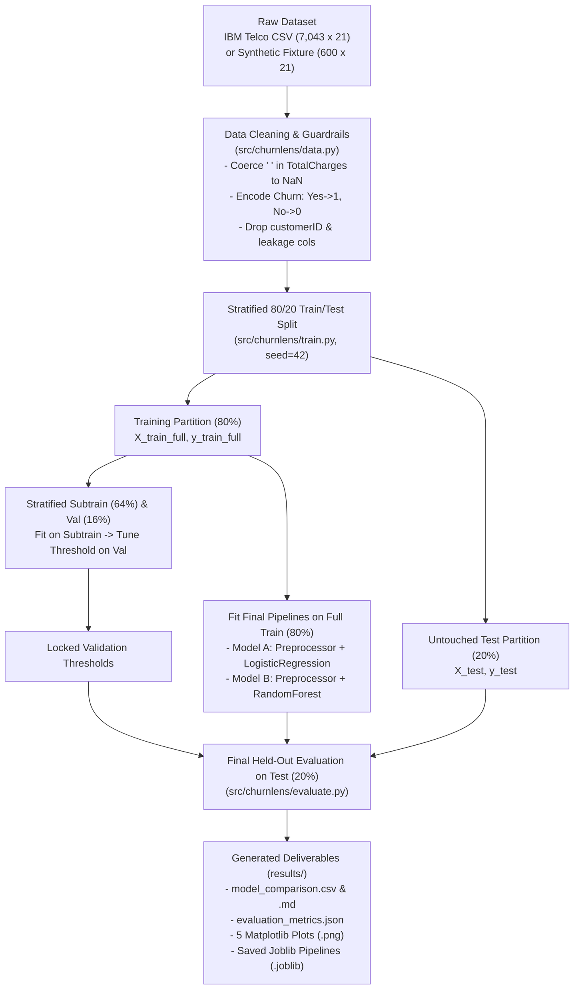

# System & Pipeline Architecture (`ChurnLens`)

## 1. End-to-End Data & Modeling Flow

---

## 2. Module Responsibilities (`src/churnlens/`)

| Module | Primary Responsibility | Key Functions / Classes |
| :--- | :--- | :--- |
| `config.py` | Loads and validates `configs/default.yaml` into typed dataclasses. | `ChurnLensConfig`, `load_config` |
| `data.py` | Loads raw CSV or synthetic fixture, coerces blank numeric strings (`" " -> NaN`), validates schema, and removes ID/leakage columns. | `load_churn_dataset`, `clean_blank_numeric_columns`, `inspect_dataframe`, `prepare_features_and_target`, `generate_synthetic_telco_fixture` |
| `preprocessing.py` | Separates numeric vs. categorical columns and builds an unfitted `ColumnTransformer`. | `identify_column_types`, `build_preprocessor` |
| `models.py` | Wraps the `ColumnTransformer` and estimator (`LogisticRegression` or `RandomForestClassifier`) inside a single `scikit-learn` `Pipeline`. | `build_logistic_regression_pipeline`, `build_random_forest_pipeline`, `build_model_pipelines` |
| `train.py` | Executes stratified train/val/test splitting, tunes classification thresholds on validation, fits final models, and saves `.joblib` pipelines. | `create_stratified_splits`, `select_threshold_on_validation`, `train_models_and_tune_thresholds`, `save_model_pipeline`, `load_model_pipeline` |
| `evaluate.py` | Computes binary metrics at $0.50$ and validation-tuned thresholds, permutation importance, and illustrative retention tiers. | `compute_binary_metrics`, `extract_feature_importances`, `build_illustrative_retention_plan`, `evaluate_all_models`, `export_comparison_tables` |
| `visualization.py` | Renders publication-clean PNG charts from evaluation results. | `plot_metric_comparison`, `plot_confusion_matrices`, `plot_roc_curves`, `plot_feature_importance`, `plot_threshold_tradeoff` |
| `main.py` | Provides the `churnlens` CLI (`inspect-env`, `validate-data`, `train`, `evaluate`, `predict`). | `run_full_pipeline`, `predict_customer_records`, `main` |

---

## 3. Inside the `scikit-learn` `ColumnTransformer`

When `pipeline.fit(X_train, y_train)` is called, `ColumnTransformer` executes two parallel branches strictly on `X_train`:

1. **Numeric Branch (`num`)** — applied to `['SeniorCitizen', 'tenure', 'MonthlyCharges', 'TotalCharges']`:
   - `SimpleImputer(strategy="median")`: Learns the training median of each numeric column and replaces `NaN` entries (such as the `tenure == 0` rows in `TotalCharges`).
   - `StandardScaler()`: Subtracts the training mean $\mu_{\text{train}}$ and divides by the training standard deviation $\sigma_{\text{train}}$.
2. **Categorical Branch (`cat`)** — applied to the $15$ categorical service/contract/billing columns:
   - `SimpleImputer(strategy="most_frequent")`: Replaces any missing categorical value with the training mode.
   - `OneHotEncoder(handle_unknown="ignore", sparse_output=False)`: Expands each categorical column into binary $0/1$ indicator columns. Setting `handle_unknown="ignore"` ensures that if a test record or production CSV contains an unseen category, it maps cleanly to all-zeros instead of crashing.
